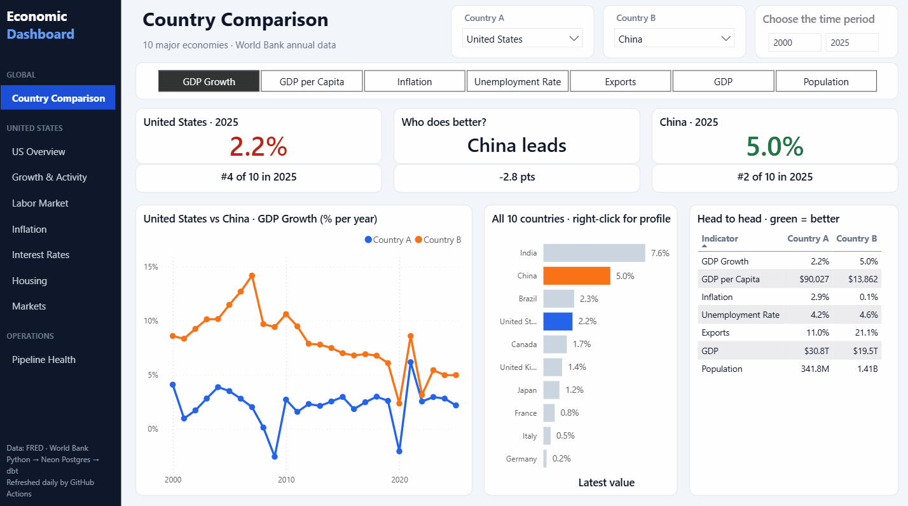
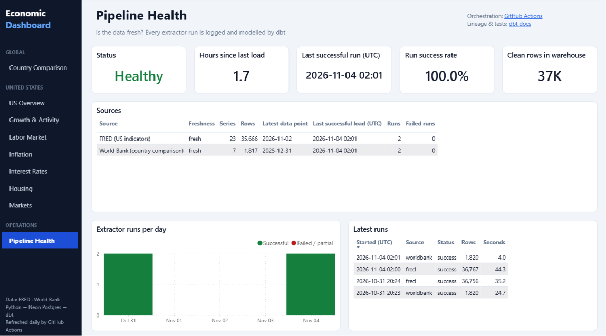
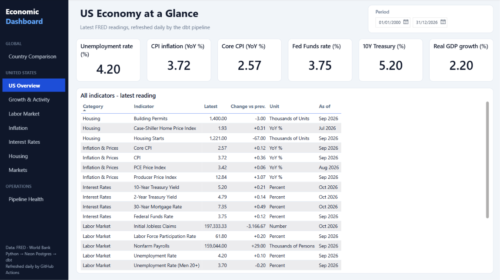

# Economic Data Warehouse

[](https://github.com/Aaron-analogical/economic-dashboard/actions/workflows/pipeline.yml)
[](https://github.com/Aaron-analogical/economic-dashboard/actions/workflows/tests.yml)
[](https://aaron-analogical.github.io/economic-dashboard/)

End-to-end analytics engineering project with two public sources: 23 US macroeconomic indicators from the Federal Reserve [FRED API](https://fred.stlouisfed.org/) and 7 annual indicators for 10 countries (G7 + China, India, Brazil) from the [World Bank API](https://datahelpdesk.worldbank.org/knowledgebase/articles/889392). Python extractors load raw data into PostgreSQL (Neon) and log every run, dbt models it into tested star schemas, and a Power BI report (PBIP, version-controlled) sits on top. Runs daily on GitHub Actions.

**dbt docs and lineage graph:** <https://aaron-analogical.github.io/economic-dashboard/>

**Explore the report yourself:** [download EconomicDashboard.pbix](https://github.com/Aaron-analogical/economic-dashboard/releases/latest/download/EconomicDashboard.pbix) (1 MB, opens in the free [Power BI Desktop](https://www.microsoft.com/power-platform/products/power-bi/desktop), Windows).

> **View only.** The file contains a snapshot of the data, so every page, filter, tooltip and drill-through works as soon as you open it. Do not click *Refresh*: it will fail, because the live database is private. The pipeline refreshes the warehouse daily; the snapshot is updated with each [release](https://github.com/Aaron-analogical/economic-dashboard/releases).



## Report

| Page | What it shows |
|---|---|
| **Country Comparison** | Pick Country A, Country B and an indicator: KPI cards coloured green/red for better/worse, A-vs-B trend, 10-country ranking with both highlighted, head-to-head table across all indicators |
| **Country Profile** | Drill-through page (right-click a country on the ranking): every indicator for one country |
| **US deep dive** (7 pages) | Overview, growth, labor market, inflation, interest rates, housing, markets from FRED |
| **Pipeline Health** | Pipeline status, hours since the last successful load, run success rate, freshness per source, run history |

Hovering a country on the ranking shows a tooltip card with its key figures. A left navigation rail and a custom theme are shared by every page.

| Pipeline Health | US Overview |
|---|---|
|  |  |

## Architecture

```
FRED API ───────► ingestion/load_raw.py ───────► raw.fred_observations
World Bank API ─► ingestion/load_worldbank.py ─► raw.worldbank_observations
                  (both extractors)          ──► raw.ingestion_runs (run log)
                                                  │
                                        dbt  ┌────┴─────────────────────────────────────────┐
                                             │ staging       stg_fred__*, stg_worldbank__*,
                                             │               stg_pipeline__ingestion_runs
                                             │ intermediate  monthly resampling, YoY / period changes
                                             │ analytics     US:      dim_indicator, dim_date,
                                             │                        fct_observations, fct_indicator_monthly
                                             │               Global:  dim_country, dim_wb_indicator,
                                             │                        fct_country_indicator_annual
                                             │               Ops:     fct_ingestion_runs, rpt_source_freshness
                                             └────┬─────────────────────────────────────────┘
                                                  │
                                   Power BI PBIP (Import, star schemas, DAX measures)

GitHub Actions: daily 07:00 UTC  →  load_raw + load_worldbank  →  dbt source freshness  →  dbt build
                push to main     →  dbt docs generate  →  GitHub Pages
```

## Stack

| Layer | Technology |
|---|---|
| Sources | FRED API (Federal Reserve Bank of St. Louis), World Bank Indicators API |
| Extract & load | Python, `requests`, `psycopg2` (batch upsert) |
| Warehouse | PostgreSQL on Neon (serverless) |
| Transformation | dbt Core 1.12 + `dbt_utils` |
| Data quality | dbt tests (unique, not_null, relationships, accepted_values, range) and source freshness |
| BI | Power BI Desktop, PBIP format (TMDL semantic model + PBIR report) |
| Orchestration | GitHub Actions |
| Documentation | dbt docs on GitHub Pages |

## Data model

| Model | Grain | Description |
|---|---|---|
| `dim_indicator` | series | Name, category, units, frequency, transform, FRED link, data coverage |
| `dim_date` | day | Calendar 2000 → end of current year (Power BI date table) |
| `fct_observations` | series × native date | Raw-frequency values (daily markets, weekly claims, …) |
| `fct_indicator_monthly` | series × month | Harmonised monthly values with period-over-period and YoY changes |
| `dim_country` | country | Name, region, group (G7 / emerging), World Bank link |
| `dim_wb_indicator` | indicator | Name, unit, whether higher is better, data coverage |
| `fct_country_indicator_annual` | country × indicator × year | Value, change vs previous year, rank among the 10 countries |
| `fct_ingestion_runs` | extractor run | Source, status, rows loaded, duration |
| `rpt_source_freshness` | source | Last successful load, row counts, latest data point, fresh / stale |

Modelling choices:

- **One monthly grain for comparisons.** Daily and weekly series are averaged per month in dbt, so every indicator can be compared on the same axis without DAX workarounds.
- **YoY computed in the warehouse, not in DAX.** Year-ago values are joined on the calendar (`month - 12 months`), not with `lag(12)`, so a missing month never shifts the comparison window.
- **`display_value`.** Price indices and volumes are reported as YoY %, rates and levels as-is. The rule is held in the `transform` column of the `indicators` seed.
- **Seeds are the single source of truth.** `indicators.csv`, `countries.csv` and `wb_indicators.csv` drive both the extractors (what to load) and the dimensions. Adding a country is a one-line change.
- **Ranking and "better/worse" in the warehouse.** `wb_indicators.better_direction` says whether higher is better; dbt ranks countries per indicator and year, so the report only displays it.
- **Observable pipeline.** Each extractor run writes a row to `raw.ingestion_runs`; dbt turns it into a freshness report the Pipeline Health page reads. Extractors run independently in CI, so one failing API does not block the other source, but the job still fails.
- **Separate dev and prod schemas.** The `prod` target writes to `staging` and `analytics`. Any other target writes to `<schema>_staging` and `<schema>_analytics`, so development never touches what Power BI reads.

## Repository layout

```
ingestion/          FRED and World Bank clients, raw loaders, run log
tests/              pytest unit tests for the extractors (HTTP and database mocked)
dbt/                dbt project: seeds, models (staging / intermediate / marts), tests, macros
powerbi/            EconomicDashboard.pbip (TMDL semantic model + report)
.github/workflows/  pipeline.yml (daily EL + dbt build), tests.yml (pytest), docs.yml (dbt docs → Pages)
```

## Setup

### Prerequisites

- Python 3.10+
- A FRED API key ([free registration](https://fred.stlouisfed.org/docs/api/api_key.html))
- A PostgreSQL database reachable from the internet (e.g. a free [Neon](https://neon.tech) project)
- Power BI Desktop (for the report)

### Install

```powershell
git clone https://github.com/Aaron-analogical/economic-dashboard.git
cd economic-dashboard
python -m venv .venv
.venv\Scripts\activate
pip install -r requirements-dev.txt   # pipeline + pytest
copy .env.example .env   # then fill in FRED_API_KEY and DB_* values
```

### Run the tests

```bash
pytest
```

The tests cover the API clients (parsing, pagination, retries, error responses) and the loaders (a failing series is logged, the others still load, and the job exits with an error). HTTP calls and the database are mocked, so no API key or database is needed. They run on every push and pull request.

### Run the pipeline locally

```bash
python -m ingestion.load_raw          # extract & load raw.fred_observations
python -m ingestion.load_worldbank    # extract & load raw.worldbank_observations (no API key needed)

cd dbt
set -a; source ../.env; set +a        # dbt reads credentials from env vars (Git Bash)
dbt deps --profiles-dir .
dbt build --profiles-dir .            # dev target → dbt_dev_staging / dbt_dev_analytics
dbt build --profiles-dir . --target prod
dbt docs generate --profiles-dir . && dbt docs serve --profiles-dir .
```

In PowerShell, load the variables with `Get-Content ..\.env | ForEach-Object { if ($_ -match '^([^#=]+)=(.*)$') { Set-Item "env:$($matches[1])" $matches[2] } }`.

### GitHub Actions

1. Add the repository secrets `FRED_API_KEY`, `DB_HOST`, `DB_PORT`, `DB_NAME`, `DB_USER`, `DB_PASSWORD`.
2. *Settings → Pages → Source: GitHub Actions* to publish the dbt docs.
3. `Tests` runs on every push and pull request. `Data Pipeline` runs daily at 07:00 UTC and can be triggered manually. `dbt Docs` runs on every push to `main` that touches `dbt/`.

### Power BI

1. Open `powerbi/EconomicDashboard.pbip` in Power BI Desktop.
2. *Transform data → Edit parameters*: set `PgHost` (Neon host) and `PgDatabase`.
3. *Refresh*. When prompted, choose **Database** authentication with your Neon user and password. Credentials are stored locally and never written to the project files.

The semantic model includes these measures:

- `Latest Value`, `Previous Value`, `Change vs Previous` and `Latest YoY %`, for KPI cards.
- `10Y-2Y Spread`, the slope of the yield curve. A negative value means the curve is inverted.
- `Real Fed Funds Rate`: the Fed Funds rate minus CPI inflation (YoY).
- `Display Value` and `Native Value`, for time-series charts. `Selected Unit` provides dynamic titles.
- Country comparison: `Value A/B`, `Latest Value A/B`, `Rank A/B`, `Gap A-B`, `Leader`, `Color A/B`. The `Country A` and `Country B` slicer tables are disconnected and applied with `TREATAS`, so the same fact table answers both sides.
- Pipeline: `Pipeline Status`, `Hours Since Refresh`, `Success Rate`, `Rows in Warehouse`.

## Indicators

| Category | Indicators |
|---|---|
| Macroeconomic | Real GDP growth |
| Labor Market | Unemployment rate, labor force participation, initial jobless claims, nonfarm payrolls, unemployment rate (men 20+) |
| Inflation & Prices | CPI, core CPI, PCE price index, PPI (all commodities) |
| Interest Rates | Fed Funds rate, 2Y and 10Y Treasury yields, 30Y mortgage rate |
| Housing | Housing starts, building permits, Case-Shiller home prices |
| Production & Business | Industrial production, retail sales, disposable personal income |
| Markets | S&P 500, VIX, broad USD index |

The full list with FRED series IDs and units is in [dbt/seeds/indicators.csv](dbt/seeds/indicators.csv).

Country comparison (World Bank, annual, 2000 onwards): GDP growth, GDP per capita, inflation, unemployment rate, exports (% of GDP), GDP and population for the United States, Canada, United Kingdom, France, Germany, Italy, Japan, China, India and Brazil. See [dbt/seeds/wb_indicators.csv](dbt/seeds/wb_indicators.csv) and [dbt/seeds/countries.csv](dbt/seeds/countries.csv).